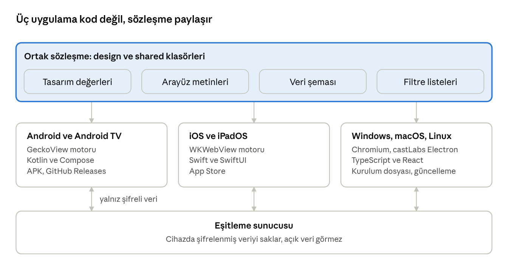
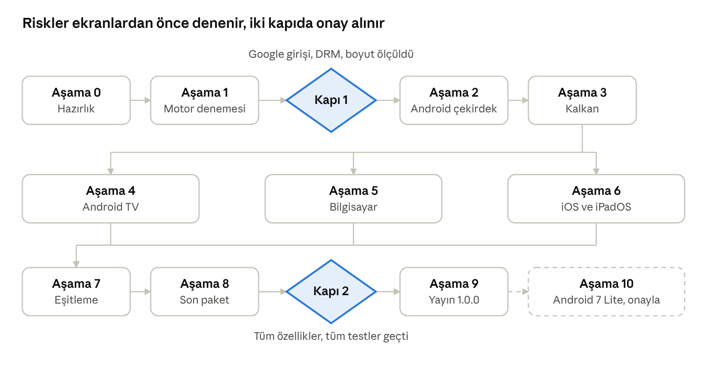

# EymenBrowser Proje Şartnamesi

Nov 4, 2026 · @Muhammet

## Özet

EymenBrowser tek bir tasarım ve tek bir özellik listesiyle yapılır, ama üç ayrı kod tabanı olur: Android ve Android TV, iOS ve iPadOS, bilgisayar. Her platform orada gerçekten çalışan motoru kullanır. Bu belge yazılım aracının uyacağı tek kaynaktır; ekranlar ayrıca "EymenBrowser Ekran Tasarımları" tuvalindedir.

İsteğin üç yerde teknik sınıra takılıyor. Aşağıdaki kararlar bu sınırların en geniş kapsamıdır.

| İsteğin | Gerçek durum | Bu projedeki karar |
| --- | --- | --- |
| Android'in bütün sürümleri | [GeckoView Android 8.0 ister](https://wiki.mozilla.org/Special:MobileDiff/1256986); [Chromium Android 10 ister](https://groups.google.com/a/chromium.org/g/chromium-dev/c/vEZz0721rUY) | Ana sürüm Android 8.0 ve üstü. Android 7 için güvenlik uyarılı Lite sürüm, son aşamada |
| iOS'un bütün sürümleri | [Apple, iOS 12 hedefli yüklemeyi reddediyor; Xcode 26 ve 27 için taban iOS 15](https://developer.apple.com/forums/thread/845219) | iOS ve iPadOS 15 ve üstü |
| Bütün televizyonlar | [Apple TV'de web görünümü yok](https://docs.rs/cacao/latest/cacao/webview/index.html); [Samsung Tizen'de siteler iframe içinde açılmayı engelleyebiliyor](https://playsignage.com/blog/how-we-build-the-tizen-app-for-samsung/) | Android TV ve Google TV. Samsung, LG ve Apple TV bu sürümde yok |
| Bütün bilgisayarlar | [Electron 44 macOS 13 ister ve 32 bit desteğini kaldırdı](https://github.com/bervProject/electron-sample/pull/276); [Windows 7, 8 ve 8.1 desteği Electron 23 ile bitti](https://thorium.edrlab.org/th3/400_ressources/390_requirements) | Windows 10 ve 11, macOS 13 ve üstü, Linux; hepsi 64 bit |
| 500 MB dosya boyutu | Motorun boyutu platforma göre çok değişir; boş dolgu tarayıcıyı hızlandırmaz | 500 MB her kurulum dosyasının üst sınırıdır. Hedef değil, tavandır |
| Tarayıcıda olması gereken her şey | Platformlar aynı şeye izin vermez; örneğin iOS'ta tarayıcı eklentisi planlanmadı | Numaralı listede 64 özellik var. Her özelliğin platform durumu yazılıdır |

Varsayımlarım: ana dil Türkçedir, ikinci dil İngilizcedir. Dağıtım Android'de GitHub üzerinden APK ile yapılır. Açılış ekranında M. Muhammet Atasoy imzası ve Globalworkm kanal adı yer alır. Yapay zekâ asistanı ilk sürümde yoktur; sunucu ve API maliyeti gerektirir.

## Yazılım aracına ana komut

Aşağıdaki metin yazılım aracına ilk mesaj olarak verilir. Araç bu şartnamenin dışına çıkamaz.

```text
Sen EymenBrowser projesinin uygulayıcısısın. Karar verici değilsin.
Tek kaynak docs/SARTNAME.md dosyasıdır. Önce onu ve docs/DURUM.md dosyasını
tamamen oku. Sonra DURUM.md'de yazan sıradaki aşamadan devam et.

Aşağıdaki kuralların hepsi zorunludur:
1. Şartnamede yazmayan özellik, ekran, renk, yazı tipi, kütüphane veya servis ekleme.
2. Yazan hiçbir şeyi çıkarma, sadeleştirme veya daha iyisiyle değiştirme.
3. Renk ve ölçüleri elle yazma. Hepsini design/tokens.json dosyasından üret.
4. Her ekranı design/ekranlar içindeki görsel ve design/kaynak içindeki HTML ile
   birebir yap. Görsel ile şartname çelişirse şartname geçerlidir.
5. Aşamaları sırayla yap. Kabul ölçütleri geçmeden sonraki aşamaya geçme.
6. Bitti demeden önce kabul ölçütlerini gerçekten çalıştır.
   Çalıştıramadığın ölçütü "denenmedi" diye yaz.
7. Her commit'te DURUM.md'yi güncelle: aşama, biten iş, sıradaki iş, açık sorun.
8. Bir kural uygulanamıyorsa dur. SAPMA.md'ye ne istendiğini, neden olmadığını
   ve iki seçeneği yaz. Kullanıcı onayı olmadan sapma yapma.
9. Tüm sürümleri versions.toml dosyasında sabitle. Sürüm yükseltmeyi ayrı commit yap.
10. Telemetri, analitik, reklam veya izleme kodu ekleme.
11. Anahtar, şifre ve imza dosyasını depoya koyma. GitHub Secrets kullan.
12. Arayüz metinlerini koda yazma. Hepsi shared/i18n dosyalarında dursun.
13. Sertifika denetimi, sandbox ve site yalıtımı gibi güvenlik önlemlerini kapatma.
```

Bu kuralların dört desteği vardır:

- **docs/SARTNAME.md:** bu belgenin Markdown çıktısı. Sadece Muhammet Atasoy değiştirir.
- **docs/DURUM.md:** işin nerede kaldığını yazar. Başka bir hesapla veya başka bir araçla devam etmeyi sağlar.
- **docs/SAPMA.md:** onay bekleyen sapmaların listesidir. Dolu olduğu sürece araç o konuda ilerlemez.
- **CI denetimi:** tasarım değerleri, 500 MB sınırı ve yasak bağımlılıklar her commit'te otomatik denetlenir. Denetim geçmezse birleştirme yapılmaz.

## Platform ve motor kararları

Android ve Android TV GeckoView, iOS WebKit, bilgisayar Chromium kullanır. Bu tablo değiştirilemez; değişiklik için SAPMA.md gerekir.

| Platform | Motor | Arayüz kodu | En düşük sürüm | Çıktı | Eklenti |
| --- | --- | --- | --- | --- | --- |
| Android telefon, tablet | GeckoView | Kotlin, Jetpack Compose | Android 8.0 (API 26) | İşlemciye özel APK: arm64-v8a, armeabi-v7a, x86\_64 | Firefox eklentileri |
| Android TV, Google TV | GeckoView | Kotlin, Compose for TV | Android 8.0 (API 26) | İşlemciye özel APK | Yok |
| iOS, iPadOS | WKWebView | Swift, SwiftUI | 15.0 | App Store | Yok |
| Windows | Chromium, castLabs Electron | TypeScript, React | Windows 10 ve 11, 64 bit | .exe kurulum | Chrome eklentileri |
| macOS | Chromium, castLabs Electron | TypeScript, React | macOS 13 | .dmg | Chrome eklentileri |
| Linux | Chromium, castLabs Electron | TypeScript, React | 64 bit | AppImage, .deb | Chrome eklentileri |
| Android 7 Lite, son aşama | Sistem WebView | Kotlin, Jetpack Compose | Android 7.0 (API 24) | Ayrı APK | Yok |

Kararların gerekçesi:

- **Android için GeckoView:** Mozilla, [sistem WebView'in tarayıcı yapmak için tasarlanmadığını ve birçok web özelliğinin kapalı olduğunu](https://wiki.mozilla.org/Mobile/GeckoView) belirtiyor. GeckoView uygulamaya gömülü gelir, [eklenti kurma API'si](https://firefox-source-docs.mozilla.org/mobile/android/geckoview/design/managing-extensions.html) ve [çeviri denetleyicisi](https://firefox-source-docs.mozilla.org/_sources/mobile/android/geckoview/contributor/translations-toolkit-to-fenix.md.txt) sunar. Android 8.0 tabanı [Firefox 144 ile gelen sınırdır](https://blog.mozilla.org/futurereleases/2025/09/15/raising-the-minimum-android-version-for-firefox/). Aynı duyuru 32 bit x86 desteğini kaldırır, bu yüzden x86 APK yoktur.
- **Chromium çatallaması yok:** [Chromium Android 10 ister](https://groups.google.com/a/chromium.org/g/chromium-dev/c/vEZz0721rUY), yani Android 8 ve 9 dışarıda kalır. Bu projenin GitHub Actions düzeninde sürdürülmesi de gerçekçi değildir.
- **iOS için WKWebView:** [Apple kuralı 2.5.6 WebKit ister](https://kiledjian.com/2025/09/29/apples-walled-garden-why-browser.html). Başka motor yalnız [AB ve Japonya'ya özel izinle](https://applemagazine.com/webkit-iphone-browsing-control/) kullanılabilir. Türkiye bu kapsamda değildir.
- **iOS 15 tabanı:** [Apple mühendisi iOS 12 hedefinin artık desteklenmediğini, Xcode 26 ve 27 için tabanın iOS 15 olduğunu](https://developer.apple.com/forums/thread/845219) 2026 Eylül'ünde yazdı.
- **Bilgisayar için Electron:** Tauri sistem web görünümünü kullanır; [Windows, macOS ve Linux'ta farklı motorlar çalışır](https://blog.scottlogic.com/2023/02/01/webview2-electron-challengers-and-slightly-lighter-desktop-web-applications.html). Electron her yerde aynı Chromium'u getirir. [castLabs sürümü Widevine ekler](https://github.com/castlabs/electron-releases). [electron-chrome-extensions](https://github.com/samuelmaddock/electron-browser-shell/blob/master/packages/electron-chrome-extensions/README.md) Chrome eklenti API'lerini taşır.
- **Reklam engeli:** bilgisayarda [@ghostery/adblocker-electron](https://github.com/ghostery/adblocker) (MPL-2.0), Android'de aynı kütüphanenin WebExtension sürümü yerleşik eklenti olarak çalışır. iOS'ta aynı listeler WebKit içerik kurallarına dönüştürülür.

Kapsam dışı: Apple TV, Samsung Tizen, LG webOS, Windows 7 ve 8, 32 bit bilgisayarlar, yapay zekâ asistanı.

## 500 MB boyut bütçesi

Her kurulum dosyası en fazla 500 MB olur. CI bu sınırı aşan derlemeyi reddeder. Boş dolgu eklemek yasaktır; dosya büyüdü diye tarayıcı hızlanmaz.

GeckoView tabanında yapılmış bir tarayıcı projesi [arm64 için yaklaşık 192 MB, tüm işlemciler için yaklaşık 514 MB](https://huggingface.co/datasets/Offlin33er/offdigitz-browser) APK raporluyor. Bu yüzden tüm işlemcileri taşıyan tek APK yapılmaz. Her işlemciye ayrı APK üretilir.

Aşağıdaki sayılar ölçüm değil, üst sınırdır. Gerçek değerler Aşama 1'de ölçülüp DURUM.md'ye yazılır.

| Bölüm | Android, TV (MB) | Bilgisayar (MB) | iOS (MB) |
| --- | --- | --- | --- |
| Tarayıcı motoru | 220 | 300 | 0, sistemde |
| Uygulama kodu ve arayüz | 40 | 40 | 40 |
| Yazı tipleri ve simgeler | 10 | 10 | 10 |
| Hazır reklam filtreleri | 20 | 20 | 20 |
| Çevrimdışı çeviri, Türkçe ve İngilizce | 110 | 110 | 0 |
| Yedek pay | 100 | 20 | 430 |
| **Toplam tavan** | **500** | **500** | **500** |

iOS dosyası motor sistemde olduğu için çok daha küçük kalır. Bu normaldir. Sınır kurulum dosyası içindir; kurulumdan sonra diskte kaplanan alan daha büyük olabilir.

## Tasarım kuralları

Görünümün adı Gece Pusulasıdır: lacivert zemin, tek elektrik mavisi vurgu, sessiz yüzeyler. Tüm değerlerin kaynağı design/tokens.json dosyasıdır. Android, iOS ve bilgisayar temaları bu dosyadan otomatik üretilir.

| Tema | Zemin | Yüzey 1 | Yüzey 2 | Yüzey 3 | Yazı | İkincil yazı | Vurgu | Vurgu üstü |
| --- | --- | --- | --- | --- | --- | --- | --- | --- |
| Gece | #0A0F1C | #121A2B | #1B2540 | #26324F | #F1F4FA | #A9B6CF | #4DA3FF | #06101F |
| Gündüz | #F5F7FB | #FFFFFF | #E9EEF7 | #DCE4F2 | #0E1526 | #45526B | #0B5FD0 | #FFFFFF |
| Gizli | #120E24 | #1D1736 | #2A2150 | yok | #F3F0FB | #BDB2DA | #B79CFF | #140C2B |

Koruma rengi geceleri #3DD6A3, gündüzleri #0B7A57'dir. Uyarı #FFB547 ve #8A5600, tehlike #FF8A80 ve #BF2A20'dir. Yazı ve vurgu renkleri bulundukları yüzeylerde en az 4,5:1 kontrast verir; bu oranlar hesaplanarak denetlendi.

| Ölçü | Telefon | Bilgisayar | TV (1920 x 1080) |
| --- | --- | --- | --- |
| Gövde yazısı | 15 | 14 | 28 |
| En küçük yazı | 12 | 12 | 24 |
| Büyük başlık | Sora 30 | Sora 44 | Sora 40 |
| Dokunma veya odak alanı | 48, en az 44 | 36 | 88 |
| Köşe yarıçapı, kart | 16 | 16 | 20 |
| Adres çubuğu yüksekliği | 48 | 36 | 112 |
| Güvenli kenar | Sistem belirler | Yok | 96 yatay, 54 dikey |

Değişmez tasarım kuralları:

1. Yazı tipleri Inter ve Sora'dır. Sora yalnız marka adında ve büyük başlıklarda kullanılır. İkisi de uygulamaya gömülü gelir.
2. Simgeler 24 birimlik ızgarada, 1,8 çizgi kalınlığında, yuvarlak uçludur. Yollar tokens.json içindedir. Emoji kullanılmaz.
3. Vurgu rengi ekranda tek ana işi gösterir. İki ana düğme yan yana konmaz.
4. Kalkan her yerde koruma rengidir. Kalkan kapalıyken uyarı rengine döner.
5. Türkçe büyük harf dönüşümü Türkçe dil kurallarıyla yapılır. Arayüzde tümü büyük harf metin yoktur.
6. TV'de seçili öğe 4 birim #F1F4FA çerçeve ve 1,06 büyüme ile gösterilir, geçiş 120 ms sürer. Yalnızca renk değişimi yetmez.
7. Sahte durum çubuğu çizilmez. Güvenli alanlar sistemden okunur.
8. Kullanıcı hareketi azaltma ayarını açtıysa animasyonlar kapanır.
9. Gerçek site logoları uygulamaya gömülmez. Kısayolda sitenin kendi simgesi çalışma anında alınır, yoksa ilk harf gösterilir.

Logo iki parçadır: dünyayı anlatan açık halka ve E harfini kuran üç sekme. Oranı değiştirilmez.

```svg
<svg viewBox="0 0 64 64">
  <path d="M46 10.5A26 26 0 1 0 46 53.5" fill="none" stroke="#4DA3FF" stroke-width="7" stroke-linecap="round"/>
  <rect x="21" y="17" width="33" height="7" rx="3.5" fill="#F1F4FA"/>
  <rect x="21" y="28.5" width="24" height="7" rx="3.5" fill="#4DA3FF"/>
  <rect x="21" y="40" width="33" height="7" rx="3.5" fill="#F1F4FA"/>
</svg>
```

Açılış hareketi en fazla 900 ms sürer. Halka 420 ms'de çizilir. Üç sekme 300, 400 ve 500. ms'de soldan 240 ms'de girer. Marka adı 560. ms'de, imza 640. ms'de belirir. Gündüz temasında logonun halkası ve orta sekmesi #0B5FD0, diğer iki sekmesi #0E1526 olur.

## Ekran listesi

Projede 16 temel ekran vardır: 11 telefon, 2 bilgisayar, 3 TV. Her kodun görseli design/ekranlar, HTML kaynağı design/kaynak klasöründedir. Aynı kod farklı platformda aynı görev ve aynı metinle çalışır.

| Kod | Ekran | Düzen ve davranış |
| --- | --- | --- |
| T01 | Açılış | Ortada 152 birim logo ve marka adı. Altta M. Muhammet Atasoy, Globalworkm. En fazla 900 ms. Soluk daireler dekoratif. |
| T02 | İlk kurulum | Üç kart: Kalkan açma, arama motoru, adres çubuğu konumu. Ana düğme Başla. Altında varsayılan tarayıcı yapma bağlantısı. Yalnız ilk açılışta çıkar. |
| T03 | Yeni sekme | Marka şeridi, 4 sütun 2 satır kısayol, Kaldığın yerden listesi, haftalık Kalkan kartı. Altta adres çubuğu ve beş düğmeli gezinme: Geri, İleri, Ana sayfa, Sekme sayısı, Menü. |
| T04 | Sayfa görünümü | Sayfa tam ekran. Sayfa kaydırılınca alt çubuk gizlenir, yukarı kaydırınca döner. Adres çubuğunda Kalkan simgesi, engel sayısı, alan adı, Yenile. Çeviri önerisi alt çubuğun üstünde açılır. |
| T05 | Kalkan paneli | Alttan açılan panel, 624 birim. Ana anahtar, üç sayı kutusu, dört site ayarı, Bu sitenin tüm izinleri. Kalkan kapanınca simge uyarı rengine döner, sayfa yeniden yüklenir. |
| T06 | Sekmeler | Üç bölüm: Sekmeler, Gizli, Cihazlar. Üstte grup düğmeleri. Sekmeler iki sütun küçük resim. Etkin sekmede 2 birim vurgu çerçevesi. Altta Tümünü kapat ve Yeni sekme. |
| T07 | Menü | Alttan açılan panel, 628 birim. 4 sütun 3 satır işlem, Sayfa boyutu denetimi, Eklentiler, Tema, Ayarlar. Sayfa boyutu yüzde 50 ile 300 arası, 10'ar adım. |
| T08 | İndirmeler | Dört süzgeç: Tümü, Video, Belge, Dosya. Her satırda dosya adı, boyut ve hız, işlem düğmesi. Hata tehlike rengiyle yazılır, Yeniden dene gösterilir. |
| T09 | Gizli sekme | Gizli teması. Neyin silindiği ve neyin görülebildiği dürüstçe yazılır. Geri dönünce kilit sor anahtarı. Metin değiştirilemez. |
| T10 | Ayarlar | Arama, eşitleme kartı ve 10 ana grup: Kalkan ve gizlilik, Şifreler, Arama motoru, Görünüm, Eklentiler, Site izinleri, İndirmeler, Dil ve çeviri, Çocuk modu, Hakkında. |
| T11 | Gündüz teması | T03 ile aynı düzen, gündüz renkleri. Tüm telefon ekranları bu kuralla gündüz temasına taşınır. |
| P01 | Bilgisayar yeni sekme | Yatay sekmeler 36 yükseklik, 196 genişlik. Araç çubuğu 50. Ortada en fazla 1040 genişlik: başlık, 60 yükseklik arama, 8 kısayol, iki kart. Pencere düğmeleri sistemin konumundadır. |
| P02 | Dikey sekme, bölünmüş ekran | 252 genişlik dikey sekmeler, gruplar. İki sayfa yan yana, etkin sayfada 2 birim vurgu çerçevesi. Kalkan paneli 324 genişlik, Kalkan düğmesinin altında açılır. |
| V01 | TV ana ekran | Marka, 112 yükseklik arama, 6 kısayol, Telefondan gönderilenler, kumanda ipuçları. Odak başlangıçta ilk kısayoldadır. |
| V02 | TV sayfa ve imleç | Sayfa tam ekran. Alt araç çubuğu 184 yükseklik, 8 düğme, odaklanan düğmenin açıklaması alt satırda. İmleç modunda yön tuşu imleci taşır, Tamam tıklar, Geri araç çubuğuna döner. |
| V03 | TV adres girişi | 112 yükseklik yazı alanı, 12 sütun Türkçe Q klavye, her tuş 96. Sağda öneriler ve Telefondan yaz QR alanı. Geri son harfi siler. |

Platform farkları:

- **Tablet:** 600 birimden geniş ekranda adres çubuğu üste çıkar, yatay sekmeler görünür, ayarlar iki sütun olur. P01 düzeni örnek alınır.
- **iOS:** aynı ekranlar SwiftUI ile yapılır. Geri kaydırma hareketi ve sistem paylaşım sayfası kullanılır. Haftalık engel sayısı gösterilmez, çünkü iOS'ta engel sayacı yoktur.
- **Bilgisayar:** T05, T07 ve T10 içerikleri açılır panel veya ayarlar sekmesi olur. Düzenleri P02 panelini izler.
- **TV:** dokunma yoktur. Her öğe yön tuşuyla ulaşılabilir olmalıdır. Odak hiçbir zaman kaybolmaz.

## Özellik listesi

EymenBrowser 64 özellikle tamamlanır. Kod yazarken özellik numarası kullanılır, liste dışında iş yapılmaz. Paket sütunu özelliğin hangi yapım paketine ait olduğunu gösterir.

| No | Özellik | Android | TV | iOS | PC | Paket |
| --- | --- | --- | --- | --- | --- | --- |
| 1 | Sekme açma, kapatma, taşıma | Var | Var | Var | Var | Çekirdek |
| 2 | Sekme grupları | Var | Yok | Var | Var | Çekirdek |
| 3 | Dikey sekmeler | Yok | Yok | Yok | Var | Çekirdek |
| 4 | Sekmede arama, son kapatılanlar | Var | Var | Var | Var | Çekirdek |
| 5 | Oturumu geri yükleme | Var | Var | Var | Var | Çekirdek |
| 6 | Uyuyan sekmeler | Var | Var | Kısıtlı | Var | Son |
| 7 | Bölünmüş ekran | Kısıtlı | Yok | Kısıtlı | Var | Son |
| 8 | Çoklu pencere | Kısıtlı | Yok | Kısıtlı | Var | Son |
| 9 | Adres çubuğu önerileri | Var | Var | Var | Var | Çekirdek |
| 10 | Arama motoru seçimi | Var | Var | Var | Var | Çekirdek |
| 11 | Yeni sekme sayfası, kısayollar | Var | Var | Var | Var | Çekirdek |
| 12 | Yer imleri ve klasörler | Var | Kısıtlı | Var | Var | Çekirdek |
| 13 | Yer imi içe ve dışa aktarma | Var | Yok | Var | Var | Son |
| 14 | Geçmiş, arama, silme | Var | Var | Var | Var | Çekirdek |
| 15 | Okuma listesi | Var | Yok | Var | Var | Son |
| 16 | Sayfada bul | Var | Yok | Var | Var | Çekirdek |
| 17 | Yakınlaştırma | Var | Var | Var | Var | Çekirdek |
| 18 | Masaüstü sitesi isteme | Var | Var | Var | Yok | Çekirdek |
| 19 | Okuma modu | Var | Yok | Var | Var | Son |
| 20 | Cihazda sayfa çevirisi | Var | Var | Kısıtlı | Kısıtlı | Son |
| 21 | PDF görüntüleyici | Var | Yok | Var | Var | Çekirdek |
| 22 | PDF kaydetme, yazdırma | Var | Yok | Var | Var | Son |
| 23 | Tam sayfa ekran görüntüsü | Var | Yok | Var | Var | Son |
| 24 | Paylaşma, QR kod üretme | Var | Yok | Var | Var | Çekirdek |
| 25 | QR kod tarama | Var | Yok | Var | Yok | Son |
| 26 | Sesle arama | Var | Var | Var | Yok | Son |
| 27 | Siteleri karanlık gösterme | Var | Var | Kısıtlı | Var | Son |
| 28 | Resim içinde resim | Var | Yok | Var | Var | Son |
| 29 | Arka planda ses, medya denetimi | Var | Kısıtlı | Var | Var | Çekirdek |
| 30 | Korumalı video (DRM) | Var | Var | Var | Var | Çekirdek |
| 31 | Web bildirimleri | Var | Yok | Yok | Var | Son |
| 32 | Web uygulaması kurma | Var | Yok | Yok | Var | Son |
| 33 | İndirme yöneticisi | Var | Kısıtlı | Var | Var | Çekirdek |
| 34 | Arka planda büyük dosya indirme | Var | Yok | Kısıtlı | Var | Son |
| 35 | Reklam ve izleyici engeli | Var | Var | Var | Var | Kalkan |
| 36 | Site bazında Kalkan açma, kapama | Var | Var | Var | Var | Kalkan |
| 37 | Engel sayacı | Var | Var | Yok | Var | Kalkan |
| 38 | Çerez pencerelerini kapatma | Var | Var | Kısıtlı | Var | Kalkan |
| 39 | Yalnızca güvenli bağlantı | Var | Var | Var | Var | Kalkan |
| 40 | Güvenli DNS | Var | Var | Yok | Var | Kalkan |
| 41 | Parmak izi koruması | Var | Var | Kısıtlı | Kısıtlı | Kalkan |
| 42 | Zararlı site uyarısı | Var | Var | Var | Var | Kalkan |
| 43 | Site izinleri | Var | Kısıtlı | Var | Var | Kalkan |
| 44 | Gizli sekme | Var | Var | Var | Var | Kalkan |
| 45 | Gizli sekmeyi kilitleme | Var | Yok | Var | Yok | Kalkan |
| 46 | Tarama verilerini silme | Var | Var | Var | Var | Kalkan |
| 47 | Şifre yöneticisi, biyometrik kilit | Var | Yok | Var | Var | Eşitleme |
| 48 | Adres ve form doldurma | Var | Yok | Var | Var | Eşitleme |
| 49 | Geçiş anahtarı (passkey) | Kısıtlı | Yok | Kısıtlı | Kısıtlı | Son |
| 50 | Uçtan uca şifreli eşitleme | Var | Var | Var | Var | Eşitleme |
| 51 | Cihaza sekme gönderme | Var | Var | Var | Var | Eşitleme |
| 52 | Telefondan TV'ye yazma | Var | Var | Var | Yok | Eşitleme |
| 53 | Eklentiler | Var | Yok | Yok | Var | Son |
| 54 | Profiller | Yok | Yok | Yok | Var | Son |
| 55 | PIN korumalı çocuk modu | Var | Var | Var | Var | Son |
| 56 | Gece, gündüz, sisteme uyma | Var | Var | Var | Var | Çekirdek |
| 57 | Adres çubuğu altta veya üstte | Var | Yok | Var | Yok | Çekirdek |
| 58 | Türkçe ve İngilizce arayüz | Var | Var | Var | Var | Çekirdek |
| 59 | Erişilebilirlik: ekran okuyucu, büyük yazı | Var | Var | Var | Var | Çekirdek |
| 60 | TV sanal imleci ve yön tuşu | Yok | Var | Yok | Yok | Çekirdek |
| 61 | TV ekran klavyesi | Yok | Var | Yok | Yok | Çekirdek |
| 62 | Geliştirici araçları | Kısıtlı | Yok | Yok | Var | Son |
| 63 | Varsayılan tarayıcı olma | Var | Yok | Var | Var | Çekirdek |
| 64 | Uygulama içi güncelleme | Var | Var | Yok | Var | Son |

Kısıtlı ifadesinin anlamı:

- **No 7, 8:** Android ve iPadOS'un kendi çoklu pencere özelliğiyle, yalnız tablette.
- **No 12, 33 TV:** yer imi ekleme ve açma var, klasör düzenleme yok. İndirme başlar, duraklatma yok.
- **No 20:** iOS'ta Apple'ın cihaz içi çeviri çatısı, bilgisayarda Firefox'un açık kaynak çeviri motoru kullanılır. İkisi de Aşama 8'de denenir, çalışmazsa SAPMA.md açılır.
- **No 27, 38, 41:** iOS WebKit'in izin verdiği kadarını sağlar. Bilgisayarda parmak izi koruması izleyici engeliyle sınırlıdır.
- **No 49:** platformun sunduğu passkey desteği kullanılır, kendi çözümümüz yazılmaz.
- **No 62:** Android'de yalnız USB ile uzaktan hata ayıklama.

## Mimari

Üç uygulama kod paylaşmaz, sözleşme paylaşır. Ortak olan yalnız tasarım değerleri, metinler, veri biçimleri ve filtre listeleridir.



Her uygulama kendi dilinde yazılır. Bir platformda değişen tasarım değeri ortak dosyadan diğerlerine geçer.

```text
EymenBrowser/
  docs/            SARTNAME.md, DURUM.md, SAPMA.md, KARARLAR.md
  design/          tokens.json, ekranlar/, kaynak/
  shared/          i18n/ (tr.json, en.json), sema/, filtre/, ikon/
  android/
    app-telefon/   telefon ve tablet uygulaması
    app-tv/        Android TV uygulaması
    core-motor/    TarayiciMotoru arayüzü ve GeckoView bağlantısı
    core-veri/     Room veritabanı
    core-tema/     tokens.json'dan üretilen tema
    ozellik-*/     sekme, adres, indirme, kalkan, ayarlar, esitleme
  ios/             SwiftUI uygulaması
  desktop/         Electron ana süreç ve React arayüzü
  sync-server/     eşitleme sunucusu
  tools/           token üretici, boyut denetimi, bağımlılık denetimi
  .github/         derleme ve yayın iş akışları
  versions.toml    tüm sürümler
```

| Konu | Android, TV | iOS | Bilgisayar |
| --- | --- | --- | --- |
| Motor bağlantısı | GeckoView, Mozilla Android Components | WKWebView | Electron WebContentsView |
| Yerel veri | Room | GRDB | better-sqlite3 |
| Şifre saklama | Android Keystore | Keychain | Electron safeStorage |
| Kalkan | @ghostery/adblocker-webextension | WKContentRuleList | @ghostery/adblocker-electron |
| İndirme | Android Components indirme modülü | WKDownload | Electron DownloadItem |
| Eklenti | GeckoView WebExtension | Yok | electron-chrome-extensions |
| Güncelleme | GitHub Releases ve PackageInstaller | App Store | electron-updater |
| Derleme | Gradle, GitHub Actions | Xcode, GitHub Actions macOS | electron-builder, GitHub Actions |

Güvenlik kuralları:

1. Electron'da `sandbox: true`, `contextIsolation: true`, `nodeIntegration: false` zorunludur. Web sayfası arayüz köprüsüne erişemez.
2. Sertifika hatasında sayfa açılmaz. Kullanıcı uyarı sayfasında açıkça kabul etmeden devam edilmez.
3. Şifreler yalnız platformun anahtar deposundaki anahtarla şifrelenir.
4. Eşitleme anahtarı kullanıcının parolasından cihazda Argon2id ile türetilir. Sunucu açık veri görmez. Parola unutulursa veri geri gelmez; kurulumda bu yazılır.
5. Eklenti imza denetimi kapatılmaz.
6. Android güncellemesinde APK imzası ve SHA-256 özeti kurulumdan önce denetlenir.
7. Motor güvenlik güncellemesi en geç 7 gün içinde yayımlanır. [GeckoView 4 haftada bir](https://wiki.mozilla.org/Mobile/GeckoView), [Electron 8 haftada bir](https://endoflife.date/electron) ana sürüm çıkarır.
8. Telemetri yoktur. Hata kayıtları cihazda kalır, kullanıcı isterse paylaşır.

## Adım adım yapım planı

Proje 10 zorunlu aşama ve 1 isteğe bağlı aşama ile biter. Riskler en başta, ekranlar yazılmadan denenir. Aşama 4, 5 ve 6 numara sırasıyla yapılır. Apple hesabı hazır değilse Aşama 6 beklemeye alınır ve DURUM.md'ye yazılır.



Kapı 1 geçilmeden ekran kodu yazılmaz. Kapı 2 geçilmeden sürüm 1.0.0 yayımlanmaz.

### Aşama 0: Hazırlık

Depo, klasör yapısı, belgeler, token üretici, metin dosyaları ve derleme iş akışları kurulur.

- [ ] Boş Android, TV, iOS ve Electron uygulamaları GitHub Actions'ta derleniyor.
- [ ] tokens.json değişince üç platformun teması otomatik üretiliyor.
- [ ] 500 MB denetimi ve yasak bağımlılık denetimi çalışıyor.
- [ ] DURUM.md ilk kayıtla duruyor.

### Aşama 1: Motor denemesi

Arayüzsüz deneme uygulamaları yapılır. Kod sonraki aşamalara taşınmak zorunda değildir. Amaç ölçmektir.

- [ ] Samsung, Tecno ve Philips TV'de GeckoView ile sayfa açılıyor.
- [ ] Google hesabına giriş Android ve Electron'da denendi, sonuç yazıldı.
- [ ] Korumalı video Android, TV ve Electron'da denendi, sonuç yazıldı.
- [ ] e-Devlet, iki banka, bir video ve bir sosyal medya sitesi her motorda denendi.
- [ ] Gerçek kurulum boyutları ölçüldü, boyut bütçesi güncellendi.
- [ ] Muhammet Atasoy sonuçları onayladı. Bu Kapı 1'dir.

### Aşama 2: Android çekirdek

T01 ile T11 arası ekranlar ve Çekirdek paketinin Android bölümü yapılır.

- [ ] Listede Paket sütunu Çekirdek olan ve Android sütunu Var veya Kısıtlı olan her özellik çalışıyor.
- [ ] 11 ekran tasarım görselleriyle yan yana karşılaştırıldı.
- [ ] Android 8, 11, 14 ve 16'da açılış, sekme, indirme testleri geçti.
- [ ] Performans hedefleri tuttu.

### Aşama 3: Kalkan

Paket sütunu Kalkan olan özellikler Android'de yapılır. Filtre listeleri uygulamayla gelir ve günde bir güncellenir.

- [ ] T05 ekranı gerçek sayılar gösteriyor.
- [ ] Site bazında kapatma kalıcı ve sayfa yenileyince etkili.
- [ ] Gizli sekme kapanınca geçmiş, çerez ve form bilgisi siliniyor.
- [ ] Test listesindeki siteler Kalkan açıkken bozulmuyor.

### Aşama 4: Android TV

V01, V02, V03, sanal imleç, ekran klavyesi ve kumanda akışı yapılır.

- [ ] Dokunmadan, yalnız kumandayla site açılıyor, gezilip kapatılıyor.
- [ ] Odak hiçbir ekranda kaybolmuyor.
- [ ] Tüm metin güvenli alan içinde ve en az 24 birim.
- [ ] Philips TV ve Android TV emülatöründe çalışıyor.

### Aşama 5: Bilgisayar

P01, P02 ve Çekirdek ile Kalkan paketlerinin bilgisayar bölümü yapılır.

- [ ] Windows 10, Windows 11, macOS 13 ve Ubuntu'da kurulup çalışıyor.
- [ ] Yatay ve dikey sekme arasında geçiş var.
- [ ] Korumalı video üretim imzalı sürümde çalışıyor.
- [ ] Güvenlik kuralı 1 otomatik testle denetleniyor.

### Aşama 6: iOS ve iPadOS

Aynı ekranlar SwiftUI ile yapılır. Apple'ın varsayılan tarayıcı kurallarına uyulur.

- [ ] iOS 15 ve en güncel iOS'ta simülatör ve gerçek cihaz testi geçti.
- [ ] Listede iOS sütunu Var veya Kısıtlı olan Çekirdek ve Kalkan özellikleri çalışıyor.
- [ ] [Apple'ın yasakladığı Info.plist anahtarları](https://developer.apple.com/documentation/xcode/preparing-your-app-to-be-the-default-browser.md) yok.
- [ ] TestFlight sürümü yüklendi.

### Aşama 7: Eşitleme

sync-server ve 47, 48, 50, 51, 52 numaralı özellikler yapılır.

- [ ] Telefon, TV, bilgisayar ve iOS arasında yer imi, sekme ve geçmiş eşitleniyor.
- [ ] Sunucu kayıtlarında açık veri olmadığı testle gösterildi.
- [ ] Telefondan gönderilen sayfa TV'de V01'de görünüyor.
- [ ] Cihazı hesaptan çıkarma çalışıyor.

### Aşama 8: Son paket

Paket sütunu Son olan özellikler yapılır.

- [ ] 64 özelliğin her biri dört platformda tek tek işaretlendi.
- [ ] Test planının tamamı geçti. Bu Kapı 2'dir.

### Aşama 9: Yayın

İmzalama, uygulama içi güncelleme, lisanslar ekranı ve gizlilik metni tamamlanır. Sürüm 1.0.0 yayımlanır.

- [ ] Android güncellemesi eski sürümden yeni sürüme sorunsuz geçiyor.
- [ ] Lisanslar ekranında tüm açık kaynak bileşenler var.
- [ ] Motor güncellemesi için otomatik derleme hattı çalışıyor.
- [ ] Windows, macOS ve Linux dosyaları yayımlandı.

### Aşama 10: Android 7 Lite (isteğe bağlı)

Sistem WebView ile ayrı APK yapılır. Yalnız Muhammet Atasoy onaylarsa başlanır. [Chrome ve WebView güncellemeleri Android 10 ve üstüne taşındığı](https://groups.google.com/a/chromium.org/g/chromium-dev/c/vEZz0721rUY) için bu sürüm eski motorla çalışır.

- [ ] Açılışta eski motor uyarısı gösteriliyor.
- [ ] Eklenti, çeviri ve Kalkan'ın desteklenmeyen bölümleri arayüzde görünmüyor.

## Test ve yayın

Bir aşama ancak kendi kabul ölçütleri ve aşağıdaki hedefler gerçek cihazda geçince biter. Araç sonuçları DURUM.md'ye sayıyla yazar.

| Hedef | Ölçüt | Sınır |
| --- | --- | --- |
| Soğuk açılış | Android orta seviye telefon, simgeden yeni sekmeye | 2,5 saniye |
| Yeni sekme | Düğmeden ekranın görünmesine | 150 ms |
| Kumanda tepkisi | TV'de tuştan odak değişimine | 120 ms |
| Kurulum dosyası | Her platform | 500 MB |
| Erişilebilirlik | Yazı kontrastı | En az 4,5:1 |

| Test ortamı | Amaç |
| --- | --- |
| Samsung, Android 14 | Günlük telefon |
| Tecno Camon Spark Slim 5G, Android 16 | En yeni Android |
| Android 8.0 emülatörü | En düşük sürüm |
| Philips 65PUS7009/62, Android 11 | Gerçek TV ve kumanda |
| Android TV emülatörü | TV'nin arızasından bağımsız test |
| Windows 10, Windows 11, macOS 13, Ubuntu | Bilgisayar sürümleri |
| iOS 15 simülatörü, gerçek iPhone | iOS alt sınır ve gerçek kullanım |

Site test listesi her motorda tekrarlanır: Google hesabı, YouTube, Gmail, WhatsApp Web, e-Devlet, iki banka, bir ödeme sayfası, Netflix veya benzeri korumalı video, bir PDF ve bir dosya indirme.

Yayın düzeni:

1. **Kanallar:** Günlük derleme yalnız test içindir. Beta GitHub ön sürümü olarak çıkar. Kararlı sürüm GitHub Releases ve App Store'dur.
2. **Sürüm numarası:** BÜYÜK.KÜÇÜK.YAMA biçimindedir. Motor güncellemesi yama numarasını artırır.
3. **İmza:** imza anahtarları GitHub Secrets'tadır. Ayrıca depo dışında güvenli bir yedek tutulur. Android imza anahtarı kaybolursa kurulu uygulamalar güncellenemez.
4. **Geri dönüş:** kötü sürüm yayından çekilir, güncelleme bilgisi önceki kararlı sürüme döndürülür.

## Riskler

En büyük risk bilgisayarda Google girişidir. Bu yüzden Aşama 1'de, arayüz yazılmadan denenir.

| Risk | Neden önemli | Ne zaman denenir | Yedek plan |
| --- | --- | --- | --- |
| Google girişi Electron'da engellenebilir | [Google gömülü motorları reddediyor](https://github.com/ChristianRelf/DandelionDEPRICATED/wiki/Troubleshooting); bu [birçok Electron tarayıcısında görülüyor](https://github.com/firebase/firebase-js-sdk/issues/2478) | Aşama 1 | Kullanıcı aracından Electron ibaresi çıkarılır. Olmazsa giriş sistem tarayıcısında yapılır. Yine olmazsa Firefox tabanlı masaüstü için SAPMA.md açılır |
| Korumalı video çalışmayabilir | [castLabs hazır sürümleri yalnız geliştirme imzalıdır, üretim için EVS gerekir](https://awesome.ecosyste.ms/projects/github.com%2Fcastlabs%2Felectron-releases) | Aşama 1 | Korumalı video bilgisayarda Kısıtlı yazılır |
| Bazı Türk siteleri Gecko'da sorun çıkarabilir | Banka ve kamu siteleri çoğunlukla Chrome ile denenir. Bu bir varsayımdır, ölçülmedi | Aşama 1 | Site bazında kullanıcı aracı değiştirme, masaüstü sitesi isteme |
| Android'de APK kurulumu zorlaşacak | [Geliştirici doğrulaması 2026 Eylül'de dört ülkede başladı, 2027'de dünyaya yayılacak](https://androidauthority.com/android-sideloading-developer-verification-first-wave-rollout-3717921) | Aşama 9'dan önce | Geliştirici doğrulaması yapılır, paket adı kaydedilir |
| Güvenlik güncellemesi kaçabilir | Güncellenmeyen tarayıcı kullanıcıyı tehlikeye atar. [castLabs güvenlik güncellemelerini en iyi çaba esasıyla verir](https://github.com/castlabs/electron-releases) | Aşama 9 | Otomatik derleme hattı, 7 günlük yayın kuralı |
| Eklentiler kısmi çalışabilir | Electron'da [Chrome API'lerinin bir kısmı ek kütüphaneyle sağlanıyor](https://github.com/fvulich/electron-chrome-extensions) | Aşama 8 | Çalışan eklentiler listesi yayımlanır |
| Siteler kumanda için yapılmamış | Çoğu site yön tuşuyla gezilmez | Aşama 4 | Sanal imleç ve telefondan yazma |
| iOS onayı gecikebilir | [Varsayılan tarayıcı izni Apple'a başvuruyla alınır](https://developer.apple.com/documentation/xcode/preparing-your-app-to-be-the-default-browser.md) | Aşama 6 | Uygulama önce varsayılan tarayıcı izni olmadan çıkar |

## Senin yapacakların

Yazılım aracı bu işleri senin adına yapamaz. Aşama 0 için yalnız ilk iki madde gerekir.

- [ ] GitHub'da EymenBrowser deposunu aç. Hesabı sen seç: mmustafatasoy veya mmaapps.
- [ ] Başlangıç paketini depoya yükle. Bu belgeyi değiştirirsen Markdown olarak indirip docs/SARTNAME.md dosyasının yerine koy.
- [ ] Aşama 1'den önce castLabs EVS hesabı aç. Bilgisayarda korumalı video için gerekir.
- [ ] Aşama 1 sonuçlarını oku ve Kapı 1'i onayla.
- [ ] Aşama 6'dan önce Apple Developer üyeliği al, test için bir iPhone bul.
- [ ] Aşama 6'da Apple'dan varsayılan tarayıcı iznini iste.
- [ ] Aşama 7'den önce eşitleme sunucusu için Cloudflare hesabı aç. Maliyeti bu aşamada netleştirilir.
- [ ] Aşama 9'dan önce Android geliştirici doğrulamasını tamamla.
- [ ] Aşama 9'dan önce Windows kod imzalama sertifikası alıp almayacağına karar ver. Sertifika yoksa Windows uyarı gösterebilir.
- [ ] Aşama 10'un yapılıp yapılmayacağına karar ver.

## Kaynaklar

Bilgiler 4 Kasım 2026'da kontrol edildi. Sürüm ve maliyet bilgileri Aşama 0'da yeniden doğrulanır.

- [Mozilla: Firefox 144 ile en düşük Android sürümü](https://blog.mozilla.org/futurereleases/2025/09/15/raising-the-minimum-android-version-for-firefox/)
- [Mozilla GeckoView belgesi](https://wiki.mozilla.org/Mobile/GeckoView)
- [GeckoView eklenti yönetimi](https://firefox-source-docs.mozilla.org/mobile/android/geckoview/design/managing-extensions.html)
- [GeckoView çeviri mimarisi](https://firefox-source-docs.mozilla.org/_sources/mobile/android/geckoview/contributor/translations-toolkit-to-fenix.md.txt)
- [Chromium: Android 8 ve 9 desteğinin bitmesi](https://groups.google.com/a/chromium.org/g/chromium-dev/c/vEZz0721rUY)
- [Apple forumu: en düşük iOS hedefi](https://developer.apple.com/forums/thread/845219)
- [Apple: varsayılan tarayıcı koşulları](https://developer.apple.com/documentation/xcode/preparing-your-app-to-be-the-default-browser.md)
- [iPhone'da WebKit zorunluluğu ve bölgesel istisnalar](https://applemagazine.com/webkit-iphone-browsing-control/)
- [Electron 44 değişiklik notları](https://github.com/bervProject/electron-sample/pull/276)
- [Electron sürüm takvimi](https://endoflife.date/electron)
- [castLabs Electron for Content Security](https://github.com/castlabs/electron-releases)
- [electron-chrome-extensions](https://github.com/samuelmaddock/electron-browser-shell/blob/master/packages/electron-chrome-extensions/README.md)
- [Ghostery reklam engelleme kütüphanesi](https://github.com/ghostery/adblocker)
- [Android geliştirici doğrulamasında ilk dalga](https://androidauthority.com/android-sideloading-developer-verification-first-wave-rollout-3717921)
- [Apple TV'de WebView bulunmaması](https://docs.rs/cacao/latest/cacao/webview/index.html)
- [Samsung Tizen'de iframe sınırı](https://playsignage.com/blog/how-we-build-the-tizen-app-for-samsung/)
- [GeckoView ile örnek APK boyutları](https://huggingface.co/datasets/Offlin33er/offdigitz-browser)
